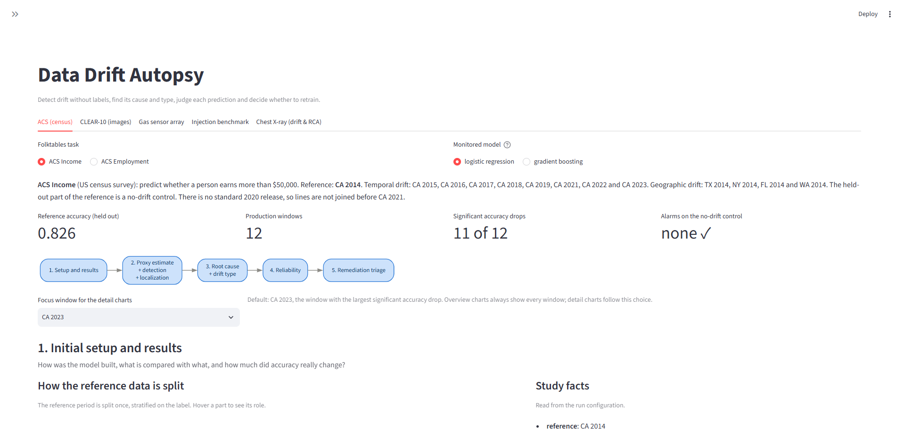
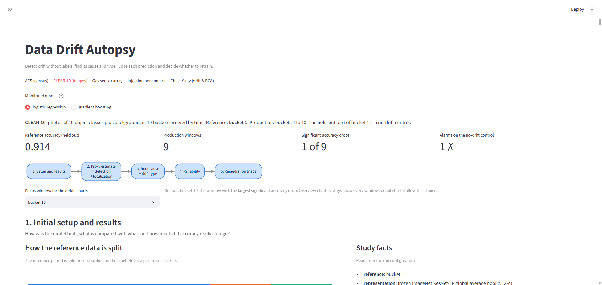
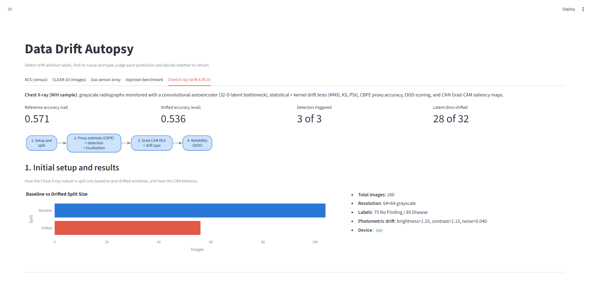
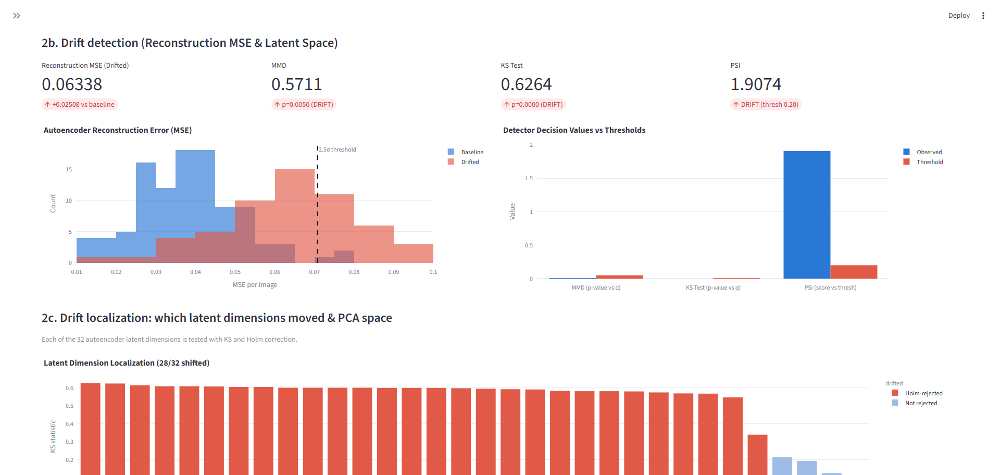
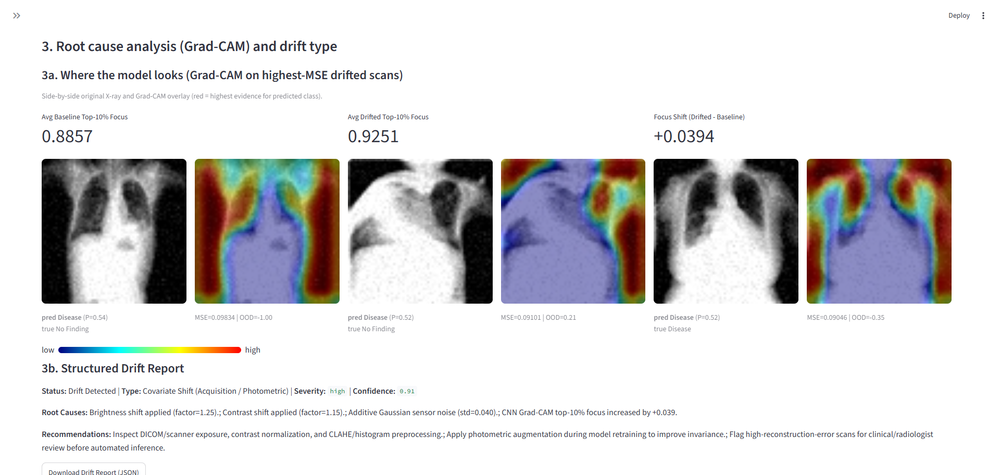

# Data Drift Autopsy

Label-free monitoring for deployed classifiers. For every window of production
data the pipeline answers, in turn: has the data changed, how much accuracy
has been lost, which features moved, what type of drift is it (covariate
shift, prior shift, concept drift or label noise) and what probably caused it,
which predictions should not be trusted and would a cheap retrain help. It
works for tabular and image models and writes one JSON report per study, which
an interactive dashboard presents.

Every decision is a hypothesis test at one significance level (α = 0.05) with
family-wise error control; nothing is tuned on the evaluation data.

Capstone project of Group 39, Department of Computer Engineering, VESIT Mumbai
(2026-27), presented in the project report as **ResilientAI: Drift Detection and
Diagnosis System**.

## What it does

| Stage | Method |
|---|---|
| Accuracy estimate | CBPE: histogram-binning map from confidence to accuracy, fitted on held-out labeled data; baselines average confidence, DoC, ATC |
| Detection | KS (numeric features, corrected), PSI, MMD / PCA reconstruction / Frechet distance permutation tests, confidence-shift chi-square test, autoencoder reconstruction MSE (Chest X-ray); baselines BBSD and a classifier two-sample test |
| Localization | KS or chi-square homogeneity per feature (Holm), effect sizes, unseen-category share, predicted-class slices, 32-D autoencoder latent localization (Chest X-ray) |
| Root cause | SHAP attribution change with bootstrap intervals (tables); CLIP concept probe, class activation maps, and CNN Grad-CAM saliency maps (images) |
| Drift type | label-free stage: input, prediction and MMD tests, black-box shift estimation, label-shift consistency; audit stage (600 late labels): accuracy-drop and error-structure tests that separate concept drift from label noise; compared with rule baselines, a learned meta-classifier and ablations |
| Reliability | confidence risk, out-of-distribution score, instability; logistic fusion learned on held-out data |
| Remediation | strategies graded by paired bootstrap; label-free triage by importance-weighted validation |

## Main results

From `outputs/` (the numbers in the paper are generated from these files):

- **Injected drift** (5300 windows, two census tasks, logistic regression and
  gradient boosting): the diagnosis names the drift type in 85.7 to 94.3% of
  windows, ahead of common monitoring rules. On drift mechanisms held out from
  the design it reaches 62.4 to 81.5%, where a learned meta-classifier falls to
  31.1 to 51.2%.
- **Limits:** a raised income threshold, which costs almost no accuracy, is
  reported as no drift; class-conditional label noise is often taken for
  concept drift.
- **False alarms:** 13 of 200 no-drift windows (6.5%, 95% CI [3.8, 10.8]),
  within the 2α bound of the two-stage procedure.
- **Real drift** (41 windows on ACS Income, ACS Employment, gas sensor drift
  and CLEAR-10): no control window is flagged and the pipeline points to
  the documented changes.
- **Negative results:** the reliability score adds nothing beyond model
  confidence and the retraining triage does no better than a simple rule. Both
  stay in the pipeline as tools.

## Install

```bash
pip install -e ".[all,dev]"     # Python >= 3.10
pip install --no-deps detectshift   # only for the published-method comparison
```

The permutation tests (MMD, Frechet distance, PCA reconstruction) run on a
CUDA GPU through PyTorch when one is available, in float64 with the same seeded
permutations as the CPU code, so the decisions are identical. Set
`DRIFT_AUTOPSY_DEVICE=cpu` to force the CPU; `DRIFT_AUTOPSY_GPU_SLOTS`
(default 4) caps how many parallel benchmark workers share the GPU. The models
(scikit-learn) run on the CPU.

## Quick start

```python
import numpy as np
from drift_autopsy import Dataset, DriftPipeline
from drift_autopsy.detectors import KSTest

rng = np.random.default_rng(0)
reference = Dataset.from_numpy(rng.normal(size=(1000, 5)))
production = Dataset.from_numpy(rng.normal(loc=0.5, size=(1000, 5)))

result = DriftPipeline(detector=KSTest(), localizer="univariate").run(reference, production)
print(result.detection.drift_detected, result.localization.drifted_features)
```

Declare nominal features with `Dataset(..., categorical_features=[...])` so
they are tested with count-based statistics.

## Dashboard

```bash
./launch_dashboard.sh [port]     # Streamlit, default port 8501
```

It walks through the pipeline step by step over the JSON reports in `outputs/`,
with charts and generated plain-language notes, and includes an interactive
**Chest X-ray (drift & RCA)** tab (`examples/dashboard/chest_xray_demo.py`) for
running live autoencoder reconstruction, 32-D latent drift detection (MMD, KS,
PSI, Holm-corrected localization), CBPE, OOD scoring, CNN Grad-CAM saliency
RCA, and structured JSON report export on local radiographs.

### Dashboard views

**ACS (census)**



**CLEAR-10 (images)**



**Chest X-ray (drift & RCA)**






## Reproducing the studies and the paper

Every study takes `--model lr` (logistic regression) or `--model hgb`
(histogram gradient boosting).

```bash
python examples/quickstart/folktables_demo.py --task income --model lr       # ACS Income, CA 2014 -> 2015-2023 and four states
python examples/quickstart/folktables_demo.py --task employment --model lr   # ACS Employment, same windows
python examples/quickstart/gas_drift_study.py --model lr                     # UCI gas sensor array drift
python examples/quickstart/clear10_tabularize_demo.py                        # once: ResNet-18 embeddings for CLEAR-10
python examples/quickstart/clear10_drift_study.py --model lr                 # CLEAR-10
python examples/quickstart/clip_concept_probe_demo.py                        # concept-level root cause
python examples/quickstart/remediation_demo.py --model lr                    # remediation and triage (after the studies)
python examples/quickstart/drift_injection_benchmark.py --dataset acs_income --design A --model lr
                                                                             # repeat for acs_employment, design B, hgb
python examples/quickstart/benchmark_summary.py                              # baselines, ablations, paired tests
python examples/paper/build_artifacts.py                                     # every number, table and figure in the paper
pytest                                                                       # unit, integration and smoke tests
```

The journal version (Bulletin of the National Research Centre) uses a second
result set with 1000 permutations in every permutation test and the same seeds,
written to `outputs/bnrc/` so that `outputs/` stays as it was:

```bash
export DDA_OUTPUTS=outputs/bnrc DDA_PERMUTATIONS=1000
# run the studies, remediation, the eight benchmark configurations and the summary as above
DDA_GEN=paper/generated/bnrc DDA_FIG=paper/figures/bnrc python examples/paper/build_artifacts.py
python examples/paper/build_bnrc.py --figures                                # manuscript and Additional file 1
```

**Data:** ACS Income and ACS Employment via
[Folktables](https://github.com/socialfoundations/folktables) (raw files under
`data/<year>/`, task caches under `data/folktables_us_census/tasks/`; from
2019 the relationship variable RELSHIPP is mapped back to RELP), the
[UCI gas sensor array drift dataset](https://archive.ics.uci.edu/dataset/224/gas+sensor+array+drift+dataset)
(downloaded and checksummed under `data/gas_sensor_drift/`), CLEAR-10 from
the [CLEAR benchmark](https://clear-benchmark.github.io/) under `data/clear10/`,
and the NIH Chest X-ray sample (`sample_labels.csv` + radiographs) under
`data/chest X ray/`. All data are public; nothing personal is collected.

## Repository layout

| Path | Contents |
|---|---|
| `src/drift_autopsy/` | the package: detectors (including `reconstruction/` autoencoder and `chest_xray_cnn`), estimation, localizers, diagnosis, rca (`grad_cam`, `cam`, `concept_probe`, `shap_analyzer`), reliability, remediation, reporting, benchmark, experiments |
| `examples/quickstart/` | study, benchmark and summary scripts |
| `examples/dashboard/` | Streamlit dashboard |
| `examples/paper/` | builds of the generated results and of each paper version |
| `outputs/` | committed JSON reports and figures (`outputs/bnrc/`: 1000-permutation set) |
| `tests/` | unit, integration and smoke tests |
| `docs/` | `02-current-implementation/`: what is implemented, why, data contracts, limitations; `01-end-goal/`: long-term product direction; `architecture/`: architecture diagram |

The paper sources, its versions and the project report live in a separate
repository, [capstone-paper](https://github.com/NathanC987/capstone-paper),
checked out under `paper/`.

## Publication

R. Guhagarkar, N. Cherian, A. Pal, A. Patre and S. Mirchandani, "Drift
Detection, Diagnosis and Reliability Analysis for Deployed Machine Learning
Models," ICMMDU 2026 (accepted, Springer Nature). A journal version for the
Bulletin of the National Research Centre is in revision. Citation metadata is in
`CITATION.cff`.

## License

MIT, see `LICENSE`.
